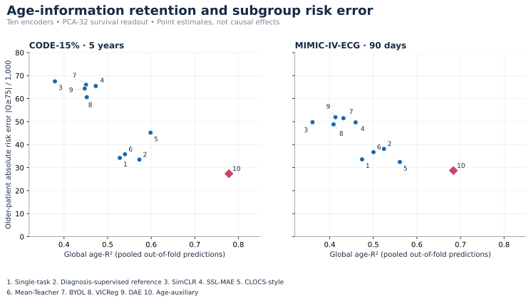
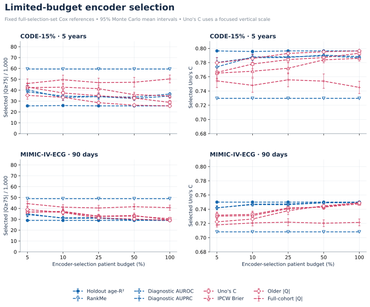
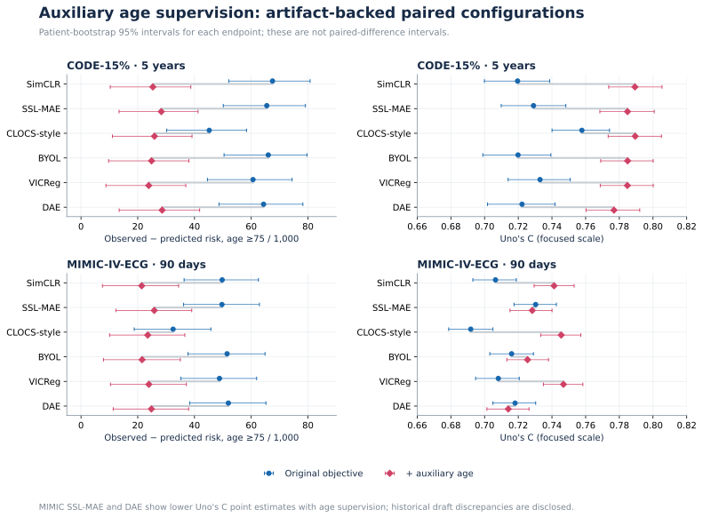
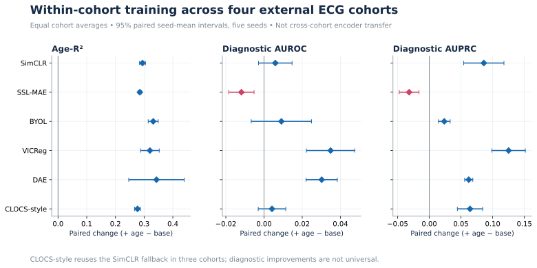

# ECG Age-Retention Audit

[Repository](https://github.com/tawnymountains/ecg-age-retention) · [Upload and Pages setup](docs/UPLOAD.md)

**Toward Reliable ECG-based Survival Models: Evaluating Age-Information Retention**

Zijian Zhao · Zihuai Lin · Gaoyang Pang · Branka Vucetic  
The University of Sydney

An inspectable research companion for evaluating **age-information retention in frozen ECG representations**, subgroup mortality-risk error, and budgeted encoder selection.

**v0.2.0 / 2026-10-14** updates the early SMS showcase to the current ten-encoder study. It includes runnable reference utilities, a synthetic demonstration, aggregate result tables and reproducible figures. It is **not an end-to-end reproduction of the private training pipeline**. The package does not contain patient data, trained checkpoints, private splits or the complete training recipe.



## Start here

| Goal | Entry point |
|---|---|
| Browse the results without installing Python | Open [`docs/index.html`](docs/index.html) locally after downloading the repository |
| View figures directly on GitHub | This README and [`docs/figures/`](docs/figures/) |
| Run a data-free example | [`examples/synthetic_demo.py`](examples/synthetic_demo.py) |
| Inspect exact displayed values | [`results/`](results/) and [`results/SCHEMA.md`](results/SCHEMA.md) |
| Understand the protocol and limitations | [`docs/METHOD.md`](docs/METHOD.md), [`docs/RELEASE_NOTES.md`](docs/RELEASE_NOTES.md) |
| Prepare your own governed experiment | [`docs/REPRODUCIBILITY.md`](docs/REPRODUCIBILITY.md), [`configs/study.template.json`](configs/study.template.json) |

## Quick start

Python 3.10 or newer. Run from the repository root in a virtual environment:

```bash
python -m pip install ".[figures]"
python examples/synthetic_demo.py
python -m unittest discover -s tests -v
python scripts/validate_public_results.py
python scripts/render_results.py
```

The demo uses **synthetic representations and survival outcomes**, not real ECGs or study patients. Its outputs are not scientific results. Figure regeneration uses the bundled **real experiment aggregates**, without retraining encoders or accessing patients. These two modes are intentionally separate.

## Current results at a glance

The primary survival readout is standardization → PCA-32 → standardization → penalized Cox, fitted independently within each survival cohort. Age probing uses the original 256-dimensional frozen representations.

| Cohort | Horizon | Encoders | Global age-R² vs. smaller older-patient error, ρagree | Without age-auxiliary |
|---|---|---:|---:|---:|
| CODE-15% | 5 years | 10 | 0.855 | 0.800 (9 encoders) |
| MIMIC-IV-ECG | 90 days | 10 | 0.818 | 0.750 (9 encoders) |

Across the ten encoders, older-patient risk underestimation ranges from **27.4 to 67.5 per 1,000** in CODE-15% and **28.7 to 51.9 per 1,000** in MIMIC-IV-ECG. These are mean-risk errors, not observed counts of missed deaths. The association does not establish a causal effect of age retention.

All ten encoders, including the diagnosis-supervised reference and less favorable comparisons, are retained in [`primary.csv`](results/primary.csv). The older subgroup is age ≥75 years. Exact rank-test results and leave-age-auxiliary-out sensitivity are in [`rank_agreement.csv`](results/rank_agreement.csv).

### Limited-budget selection



Budgets limit the patients used to **compare and select encoders**, not the final reference Cox training set. Final evaluation uses fixed references fitted on the full selection set. Consequently, these curves are not performance curves for final survival models trained with only 5%–100% of labels. Their reference fitting population also differs from the primary CODE survival analysis.

The saved budget implementation uses **holdout age-R²**, not pooled nested-OOF global age-R². This release labels it accordingly. Error bars are pointwise 95% Monte Carlo mean intervals across valid selection repetitions, conditional on the fixed evaluation; they are not patient-bootstrap CIs. Actual valid/attempted counts are provided for every curve point. MIMIC diagnostic scores use six report-derived weak-label targets, not adjudicated diagnoses.

### Auxiliary age supervision and its trade-offs



Auxiliary age supervision yields smaller older-patient risk-error point estimates for the six matched SSL methods in both cohorts. Discrimination gains are **not universal in the saved artifacts**: MIMIC SSL-MAE and DAE have lower Uno’s C point estimates after age supervision. Two values in an earlier manuscript table differ from these artifacts; the release uses the saved, checked values and discloses the mismatch in [release notes](docs/RELEASE_NOTES.md). Endpoint intervals alone are not paired-difference tests.

### Four external ECG cohorts



These are **within-cohort encoder-training experiments**, not transfer of a CODE-trained encoder. They support age/diagnostic probing, not survival evaluation. Four-cohort averages show higher age-R² with age supervision, but diagnostic improvements are not universal. In three cohorts, the CLOCS-style fallback reuses the SimCLR construction and is not independent evidence. See the [protocol notes](docs/METHOD.md#external-within-cohort-experiments).

## What the code provides

```text
src/ecg_audit/
  metrics.py       pooled age-R², Kaplan–Meier risk, subgroup Q, exact rank tests
  probing.py       patient-grouped nested Ridge probing
  selection.py     strict all-candidate selection without evaluation leakage
  survival.py      optional PCA + penalized Cox adapter
  auxiliary.py     generic age-supervision wrapper for a supplied encoder
examples/          clearly labeled synthetic demo
results/           allowlisted experiment aggregates and provenance
scripts/           result validation and deterministic figure regeneration
docs/              method, disclosure, upload instructions, offline gallery
tests/             unit and boundary-case checks
```

Install optional adapters only if needed:

```bash
python -m pip install ".[survival]"
python -m pip install ".[training-example]"
```

The age head attaches to an encoder's representation and can be removed for ECG-only inference. Chronological age can separately be supplied as a downstream Cox covariate, but that changes the inference interface; auxiliary supervision and age-as-input are distinct configurations. The generic wrapper is not the paper's private backbone or a full SSL training implementation.

## Release and data boundaries

- No waveforms, patient IDs, clinical records, individual predictions, feature matrices, linkage tables, trained weights, credentials or original patient partitions are included.
- Selected training settings are intentionally not released. `null` fields in the configuration template are explicit omissions, not defaults. Demo settings do not stand in for the scientific experiment recipe.
- The current main snapshot uses **PCA-32**. The direct-256D sensitivity experiment is excluded because its full execution/verification pipeline was incomplete at this snapshot.
- No guarantees of clinical utility, causal identification, certified reliability, or end-to-end reproducibility are made.
- Data access, publication permissions and institutional review obligations remain with the researcher. This package is not a certification of compliance with any venue, institution or data-use agreement.

See [data access](docs/DATA.md), [reproducibility scope](docs/REPRODUCIBILITY.md), [changelog](CHANGELOG.md), and [upload instructions](docs/UPLOAD.md).

## Citation and license

Use [`CITATION.cff`](CITATION.cff) for this software snapshot. Article DOI/publication metadata have not been asserted. Code is MIT-licensed, continuing the prior repository's license choice. Dataset access rights and third-party trained weights are not granted by this license. This release uses newly generated plots, not licensed BioRender artwork.
